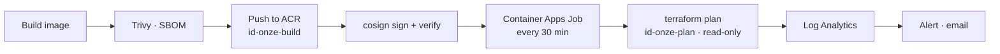

# Drift Detection
Every 30 minutes a container in Azure compares the live environment with the Terraform code on main. If someone changes a resource manually in the portal, the change is detected and an alert is sent.

### How it works
**caj-onze-drift:** scheduled job. A Container Apps Job in spoke5 starts the drift-checker container every 30 minutes.
**check.py:** the check. Clones main, runs terraform init and a read-only terraform plan -detailed-exitcode -lock=false, and writes one result line to the log: NO_DRIFT, DRIFT_DETECTED or ERROR.
**Alerts. **Two Azure Monitor rule watch the job logs in Log Analytics: one for detected drift. It notifies the existing action group by email and stay muted for 6 hours after firing.
**build-drift.yml:** image pipeline. Rebuilds the container when the checker or the Terraform providers change.

### Secretless authentication and least privilege
The job runs as `id-onze-plan`, the same read-only identity used for pull request plans. It can detect drift but cannot change anything.
The image is pulled from ACR with the same managed identity (AcrPull); the registry has the admin user disabled.
`-lock=false` keeps the check read-only, so it never blocks a real deployment.
Terraform variables are passed to the job by Terraform itself during deployment, so the check uses exactly the same values as the apply.

### Image supply chain
**Trivy**: critical vulnerabilities block the build before anything is pushed; all high and critical findings are tracked in GitHub code scanning.

**SBOM** (SPDX) attached to every image.

**Сosign keyless** signature, verified before deployment.

**Deployment by digest:** the job runs exactly the image that was scanned and signed.

**Hardened image:** official Terraform base, non-root user, provider plugins cached at build time.

### Network
The Container Apps environment is internal only, with no public ingress.
All egress goes through Azure Firewall with an FQDN allowlist: GitHub, the Terraform registry, Azure management and identity endpoints, the state storage, Key Vault and the container registries
