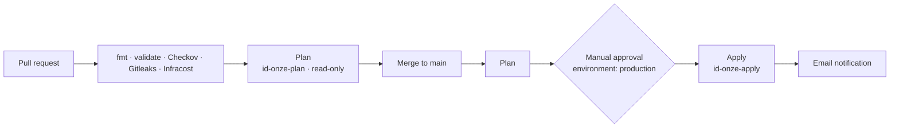

## CI/CD: GitHub Actions

Every infrastructure change goes through an automated quality gate and a manual approval before it reaches Azure. The pipeline authenticates with **OIDC federated credentials**, so no long-lived cloud secrets are stored in GitHub.

## Workflows
- **`gitleaks.yml`: secret scanning.** Scans the repository for leaked credentials such as keys, tokens and passwords.
- **`terraform-pr.yml`: pull request checks.** Runs `terraform fmt`, `terraform validate` and **Checkov** for security misconfigurations, then generates a `terraform plan` and posts it as a PR comment for review.
- **`terraform-apply.yml`: deployment.** On merge to `main`, generates a plan for review in the job summary and waits for manual approval. After approval, the apply job re-plans and applies, then **sends an email notification** with the result.
- **Infracost: FinOps.** Estimates the cost impact of every pull request and posts it as a PR comment.

## PR Terraform Plan

### Secretless authentication and least privilege
The pipeline uses two user-assigned managed identities with **OIDC federated credentials** instead of client secrets:

`id-onze-plan` Pull requests and the plan job | Read-only: Reader, state access, Key Vault secret read 
`id-onze-apply` Apply job only | Write: Contributor, Resource Policy Contributor, scoped RBAC Administrator

- Code from a pull request can only read; it cannot change anything in Azure.
- The write identity trusts only the `production` environment, which requires manual approval and is restricted to the `main` branch.
- Federated credentials are bound to **immutable GitHub owner and repository IDs**, so a renamed or recreated repository cannot reuse them.

### Deployment safety
- **Manual approval gate**: the plan is reviewed before anything is applied.
- **Serialized deployments**: a concurrency group ensures only one apply runs at a time and a running apply is never cancelled.
- **Remote state** in Azure Storage with Entra ID authentication and state locking.

> **Note:** In a team environment, branch protection on `main` would also require approval from a second reviewer before merging.

### Notifications
When the apply job finishes, the pipeline sends an email with the result (success or failure), the commit, who triggered the deployment and a link to the workflow run. Emails are sent through **Azure Communication Services** from a custom verified domain (`notify.onze.riseofforce.net`) with SPF and DKIM configured, so they are delivered reliably instead of landing in spam.

